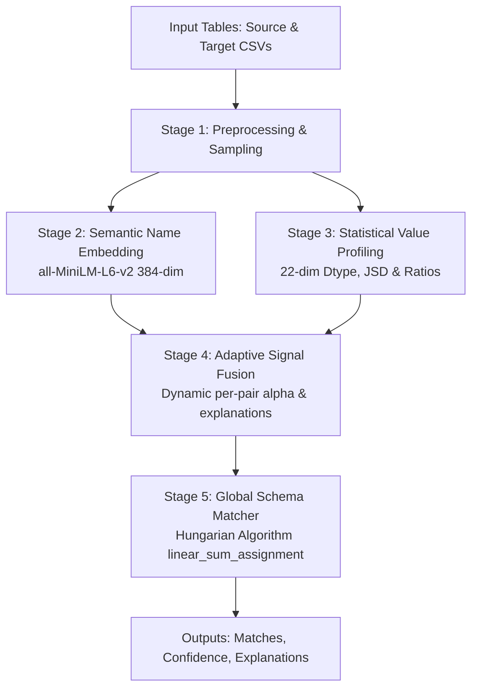

# Semantic Schema-Matching for Federated Database Integration

Automated schema matching system for federated databases that discovers 1-to-1 semantic correspondences between table columns. Instead of relying on rigid static weights or unexplainable black-box prompts, this system dynamically fuses semantic column name embeddings with statistical value distribution profiles using an adaptive, explainable per-pair weighting coefficient ($\alpha$).

---

## 1. Architecture

The pipeline executes in 5 sequential stages from raw tabular data to global bipartite assignment:



1. **Stage 1: Preprocessing & Sampling**: Tokenizes column names across naming conventions (snake_case, camelCase, PascalCase, kebab, dotted, acronyms), expands abbreviations (`cust` $\to$ `customer`, `dob` $\to$ `date of birth`, `qty` $\to$ `quantity`), and draws non-null sample values with deterministic random seeds.
2. **Stage 2: Name Embedding**: Encodes normalized tokens using `sentence-transformers/all-MiniLM-L6-v2` into 384-dimensional dense vectors with L2 normalization and in-memory caching. Falls back to character 3-gram TF-IDF hashing if offline.
3. **Stage 3: Value Profiling**: Converts value samples into fixed 22-dimensional statistical profiles capturing inferred data types (numeric, date, categorical, string, id_code), cardinality ratios, null ratios, length statistics, distribution moments (mean, std, quantiles), and regex format signatures (emails, phones, codes).
4. **Stage 4: Adaptive Signal Fusion**: Evaluates pair-specific semantic context to calculate an adaptive weight $\alpha \in [0.15, 0.85]$. Fused score is computed as:
   $$\text{Score} = \alpha \cdot \text{Sim}_{\text{name}} + (1 - \alpha) \cdot \text{Sim}_{\text{value}}$$
5. **Stage 5: Global Matching**: Constructs the fused similarity matrix and computes globally optimal one-to-one column assignments using the Hungarian algorithm (`scipy.optimize.linear_sum_assignment`), filtering candidates below a confidence threshold.

---

## 2. Adaptive Alpha Rules & Explainability

Rather than setting a constant 50/50 split, $\alpha$ is adjusted per column pair using explicit, explainable rules:

- **Base Weight ($\alpha = 0.60$)**: Column names serve as the default primary semantic indicator.
- **Generic / Short Names**: When either column name lacks specificity (e.g., `id`, `name`, `code`, `val`, `date`, length $\le 3$), $\alpha$ decreases by $0.15$ to $0.30$, shifting authority to value distributions.
- **Sparse / High-Null Values**: When samples are sparse ($< 3$ rows) or null ratio exceeds $80\%$, values are deemed unreliable, increasing $\alpha$ by $+0.20$.
- **High Semantic Match & Type Agreement**: When name cosine similarity $\ge 0.80$ and data types match, $\alpha$ receives a $+0.10$ boost.
- **Data Type Incompatibility**: If data types are incompatible (e.g. numeric vs date, numeric vs string), value similarity is penalized by $85\%$.
- **False-Friend Suppression**: If column names are generic and data types are incompatible (e.g. `status` string vs `status` HTTP integer code), $\alpha$ is clamped to the minimum ($0.15$), preventing spurious matches.
- **Bounding Clamp**: $\alpha$ is strictly clamped to $[0.15, 0.85]$ so that neither signal is entirely silenced. Every decision produces an audit trail explaining the score adjustments.

---

## 3. Evaluation & Benchmark Results

Evaluation was performed on 5 schema pairs of graded difficulty using a fixed confidence threshold of **0.35** across all four methods without test-set tuning:

- **Pair 1 (Easy)**: Abbreviations and naming style variations (`cust_id` $\leftrightarrow$ `customer_id`).
- **Pair 2 (Medium)**: Synonyms and domain terminology (`contact_mail` $\leftrightarrow$ `user_email`).
- **Pair 3 (Hard)**: Generic names where name signals mislead and values must decide (`id`, `code`, `val`).
- **Pair 4 (Hard)**: False friends with identical names but conflicting types (`status` string vs HTTP int; `age` int vs birthdate).
- **Pair 5 (Real-World)**: Asymmetric tables with unmatched columns, 80% null fields, and permuted column order.

### Benchmark Comparison Table (Real Run Output)

| Method | Pair 1 (F1) | Pair 2 (F1) | Pair 3 (F1) | Pair 4 (F1) | Pair 5 (F1) | Macro P | Macro R | Macro F1 |
|---|---|---|---|---|---|---|---|---|
| **Name-Only (alpha=1.0)** | 1.0000 | 0.9091 | 0.6000 | 0.7500 | 0.8333 | 0.8400 | 0.8295 | 0.8185 |
| **Value-Only (alpha=0.0)** | 1.0000 | 1.0000 | 1.0000 | 1.0000 | 0.8750 | 0.9556 | 1.0000 | 0.9750 |
| **Fixed-Fusion (alpha=0.5)** | 1.0000 | 1.0000 | 1.0000 | 0.7500 | 0.8750 | 0.8756 | 1.0000 | 0.9250 |
| **Adaptive Fusion** | **1.0000** | **1.0000** | **1.0000** | **1.0000** | **0.8750** | **0.9556** | **1.0000** | **0.9750** |

### Findings
1. **Generic Names (Pair 3)**: Name-only matching failed ($F_1 = 0.6000$) due to ambiguous generic tokens. Adaptive fusion recognized the generic tokens, reduced $\alpha$, and achieved $1.0000\ F_1$.
2. **False Friends (Pair 4)**: Fixed 50/50 fusion failed ($F_1 = 0.7500$) because a name similarity of $1.0$ overpowered the value signal. Adaptive fusion detected generic names with incompatible data types, suppressed the name weight, and achieved $1.0000\ F_1$.
3. **Asymmetric Schemas (Pair 5)**: Bipartite matching with confidence gating correctly left unmatched and high-null columns unassigned.

---

## 4. Installation & Setup

**Requirements**:
- OS: Windows 10/11 (PowerShell)
- Python: Version 3.12, 3.13, or 3.14 (Verified on Python 3.14.7 AMD64 with `torch 2.14.0+cpu` and `sentence-transformers 6.0.1`)

### Setup Virtual Environment

```powershell
# Create and activate virtual environment
python -m venv .venv
.\.venv\Scripts\Activate.ps1

# Upgrade pip and install dependencies
pip install -r requirements.txt
```

---

## 5. Quickstart Commands

```powershell
# 1. Run all tests (60 passed)
python -m pytest -v

# 2. Run benchmark evaluation across all schema pairs
python -m evaluation.run_evaluation

# 3. Launch interactive Streamlit web application
streamlit run app/streamlit_app.py

# Or execute everything with the automated runner:
.\run_all.ps1
```

---

## 6. Project Layout

```
schema_matching_project/
├── .streamlit/
│   └── config.toml           # Theme configuration (light theme, blue accent)
├── app/
│   ├── __init__.py
│   ├── service.py            # Core matching pipeline API (shared backend)
│   └── streamlit_app.py      # Interactive multi-tab web application
├── data/
│   ├── synthetic/            # Benchmark JSON pairs (pair_1.json .. pair_5.json)
│   └── test_schemas/         # CSV schema pairs (source.csv, target.csv, ground_truth.csv)
│       ├── schema_pair_1/
│       ├── schema_pair_2/
│       ├── schema_pair_3/
│       ├── schema_pair_4/
│       └── schema_pair_5/
├── evaluation/
│   ├── __init__.py
│   ├── baselines.py          # Baseline matchers (name-only, value-only, fixed, adaptive)
│   ├── benchmark.py          # Benchmark harness
│   ├── metrics.py            # Precision, Recall, F1 calculation
│   └── run_evaluation.py     # Evaluation entrypoint generating CSV reports
├── matching/
│   ├── __init__.py
│   └── matcher.py            # Hungarian 1-to-1 bipartite assignment
├── person_a/
│   ├── __init__.py
│   ├── fusion.py             # Adaptive alpha calculation and explainability
│   ├── name_embedder.py      # SentenceTransformer singleton with TF-IDF fallback
│   ├── name_similarity.py    # Vectorized cosine similarity
│   └── normalize_names.py    # Tokenization and abbreviation expansion
├── reports/
│   ├── comparison_table.csv  # Wide comparative performance summary
│   ├── results_long.csv      # Tidy long-format evaluation data
│   └── per_match_details.csv # Per-column match scores, alphas, and explanations
├── shared/
│   ├── __init__.py
│   ├── column_profile_schema.json  # JSON schema for profile validation
│   └── contracts.py          # Typed dataclasses (ColumnProfile, Match, MatchExplanation)
├── tests/
│   ├── test_data_generator.py
│   ├── test_embedder.py
│   ├── test_end_to_end_benchmark.py
│   ├── test_fusion_rules.py
│   ├── test_matcher.py
│   ├── test_metrics.py
│   ├── test_name_similarity.py
│   ├── test_profiler.py
│   ├── test_sampler.py
│   ├── test_similarity.py
│   └── test_streamlit_app.py
├── value_pipeline/
│   ├── __init__.py
│   ├── profiler.py           # 22-dimensional statistical profile vectorizer
│   ├── sampler.py            # Value sampling with deterministic random seed
│   └── similarity.py         # Weighted Euclidean, JSD, and discrete overlap metrics
├── conftest.py               # Adds repository root to sys.path
├── generate_synthetic.py     # Dataset generator script
├── pytest.ini                # Pytest configuration
├── requirements.txt          # Dependency specification with lower bounds
├── run_all.ps1               # Automated end-to-end execution script
└── README.md
```

---

## 7. Limitations & Future Work

1. **One-to-One Matching**: The Hungarian assignment model assumes strict 1-to-1 mappings. Compound columns (e.g., `first_name` + `last_name` $\leftrightarrow$ `full_name`) require composite column synthesis prior to Hungarian assignment.
2. **Offline Sentence Transformers**: If the pre-trained HuggingFace model cannot be downloaded, the system activates a character 3-gram TF-IDF fallback. While functional, neural semantic similarity outperforms n-gram matching on deep synonyms.
3. **Table Sample Depths**: Statistical profiles rely on representative sampling (default 500 rows). Columns with fewer than 5 rows provide weak distribution signals and rely primarily on column name semantics.
